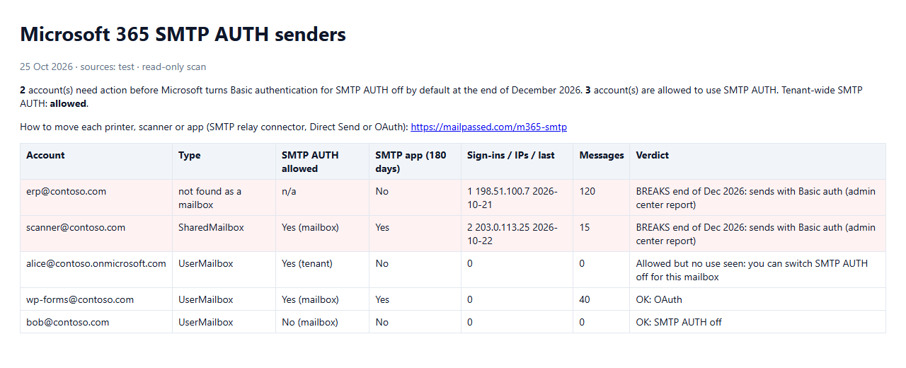

# Find-SmtpAuthSenders

**Find every mailbox, printer, scanner and app that still sends through Microsoft 365 SMTP AUTH, before Basic
authentication is turned off by default at the end of December 2026.**

A single read-only PowerShell script. It changes nothing in your tenant: it reads, combines up to four Microsoft data
sources and writes an HTML + CSV report with a verdict for every account.



## Why now

Microsoft is retiring Basic authentication for SMTP AUTH (Client Submission, `smtp.office365.com`) in Exchange Online.
Per Message Center post MC786329 (updated 27 Jan 2026), it is **disabled by default for existing tenants at the end of
December 2026**. Admins can still switch it back on for now, and Microsoft will announce the final removal date in the
second half of 2027. Devices and apps that log in with a username and password then fail, typically with
`535 5.7.139 Authentication unsuccessful`. Scan-to-email copiers are the classic case.

The hard part is knowing *what* still uses it. The Exchange admin center report only goes back 90 days and shows
senders, not where they are. This script pulls everything together in one pass.

## What it reads

| Source | Switch | What you learn | Needs |
|---|---|---|---|
| SMTP AUTH settings | always | Who is *allowed* to use SMTP AUTH: tenant setting + every mailbox (an empty mailbox value means the tenant setting applies, and the script resolves it) | `ExchangeOnlineManagement`, a role that can read mailboxes |
| Email app usage report, **180 days** | `-IncludeUsageReport` | Which accounts actually sent with an "SMTP App" (Graph `getEmailAppUsageUserDetail`) | `Microsoft.Graph.Authentication`, Reports.Read.All + a role such as Reports Reader |
| Entra ID sign-in logs | `-IncludeSignInLogs` | "Authenticated SMTP" sign-ins with **IP address**, so you can find the physical device | AuditLog.Read.All, Entra ID P1/P2 |
| Admin center CSV | `-AdminCenterCsv <file>` | **Basic (TlsAuthLogin) vs OAuth (XOAUTH2)** per sender | Export: Exchange admin center → Reports → Mail flow → SMTP AUTH clients report |

## Quick start

```powershell
# Once
Install-Module ExchangeOnlineManagement -Scope CurrentUser
Install-Module Microsoft.Graph.Authentication -Scope CurrentUser   # only for -IncludeUsageReport / -IncludeSignInLogs

# Get the script (PowerShell Gallery)
Install-Script -Name Find-SmtpAuthSenders -Scope CurrentUser
# ...or download Find-SmtpAuthSenders.ps1 from this repo, read it, then: Unblock-File .\Find-SmtpAuthSenders.ps1

# Settings only
Find-SmtpAuthSenders.ps1

# Everything
Find-SmtpAuthSenders.ps1 -IncludeUsageReport -IncludeSignInLogs -AdminCenterCsv .\smtpauth.csv
```

Output: `SmtpAuthSenders-<date>.html` and `.csv` in the current folder (`-OutputFolder` to change it).
Works in Windows PowerShell 5.1 and PowerShell 7.

## Verdicts

| Verdict | Meaning | Action |
|---|---|---|
| **BREAKS end of Dec 2026** | The admin center report shows Basic auth | Move it to a relay connector, Direct Send or OAuth |
| **CHECK** | Sent with SMTP AUTH (usage report or sign-ins), method unknown | Add `-AdminCenterCsv` to see Basic vs OAuth |
| **Allowed but no use seen** | SMTP AUTH is on, nothing used it | Switch it off for that mailbox |
| **OK: OAuth** / **OK: SMTP AUTH off** | Nothing to do | – |
| **Not a mailbox in this tenant** | A sender in the logs that isn't a mailbox (deleted account, other tenant) | Check it |

## Notes

- If the usage report shows hidden user names, untick *Display concealed user, group, and site names in all reports*
  (Microsoft 365 admin center → Settings → Org settings → Reports) and run again.
- Sign-in logs keep 30 days of history; the usage report keeps 180 days.
- Offline tests with sample data: `powershell -File .\tests\Test-Logic.ps1`. The script has been tested with sample
  data, not yet on many real tenants. If something fails on yours, please open an issue with the error message.

## Then fix each device

Step-by-step guides (relay connector, Direct Send, OAuth) for HP, Canon, Ricoh, Xerox, Brother, Konica Minolta,
Kyocera, Sharp, Lexmark, Epson, WordPress SMTP plugins, Synology/QNAP and PowerShell:
**https://mailpassed.com/m365-smtp**

Need more than the free guides?
- [Microsoft 365 SMTP Fix Kit](https://donruler.gumroad.com/l/microsoft-365-smtp-fix-kit) ($19): decision table, connector
  set-up, per-device steps, sender worksheet and checklist in one printable guide.
- [Done for you on Fiverr](https://www.fiverr.com/donrulezz/harden-and-secure-your-linux-vps-server-with-an-audit-report):
  your devices and apps moved and tested, from $25.

Maintained by [mailpassed.com](https://mailpassed.com), free email-authentication tools (SPF, DKIM, DMARC, MTA-STS).

## License

MIT. See [LICENSE](LICENSE).

## Need it done?
Printers or apps still on SMTP AUTH and no time to move them? I move each one to OAuth, a connector relay or Direct Send and
test it: [fix scan to email for Office 365 (Fiverr)](https://www.fiverr.com/donrulezz/harden-and-secure-your-linux-vps-server-with-an-audit-report).
The script stays free.
